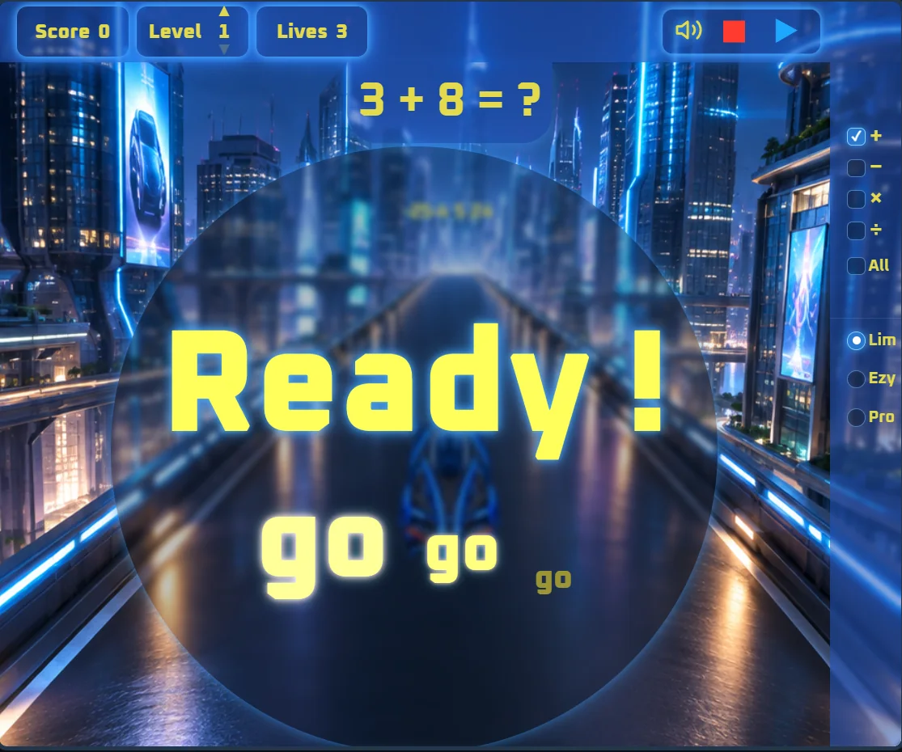
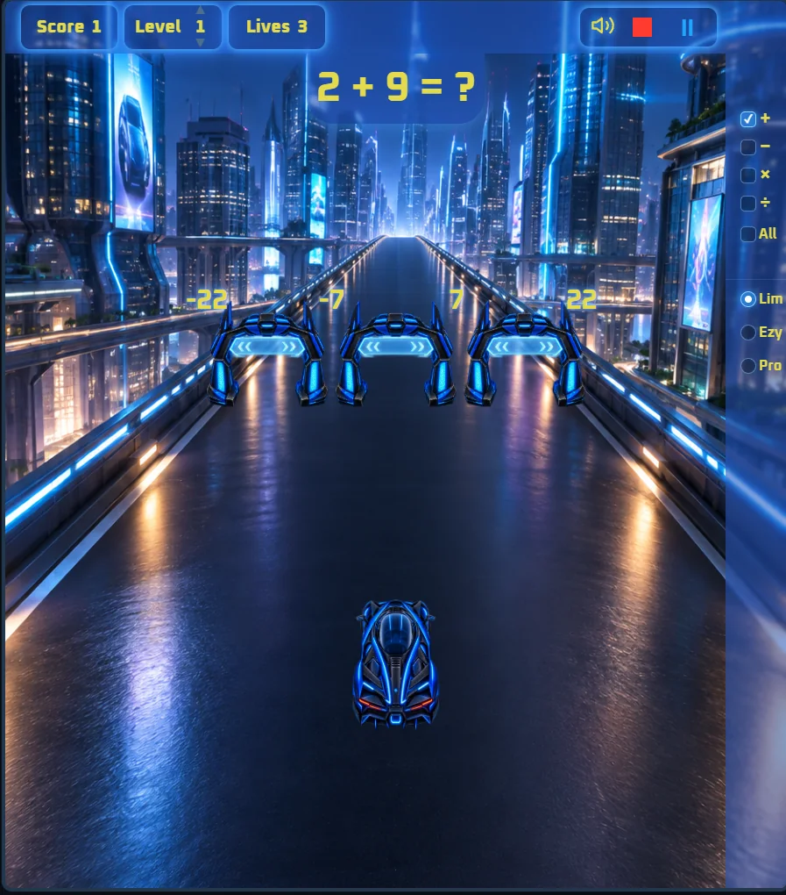
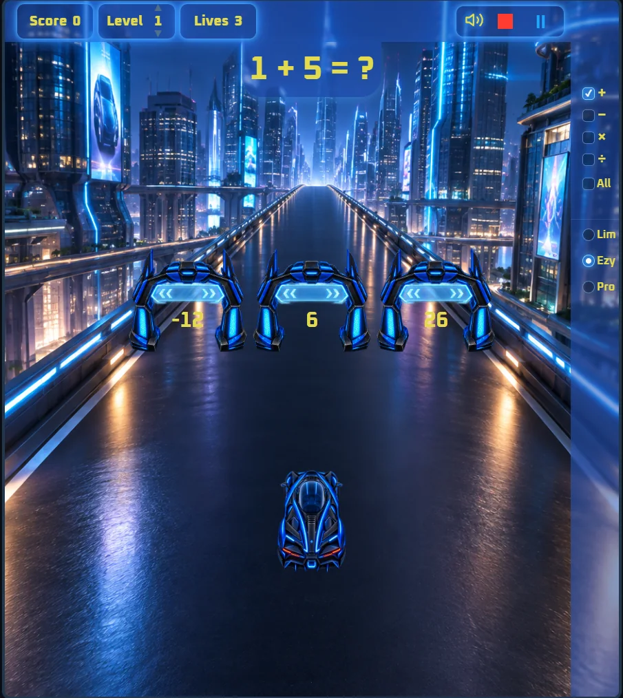
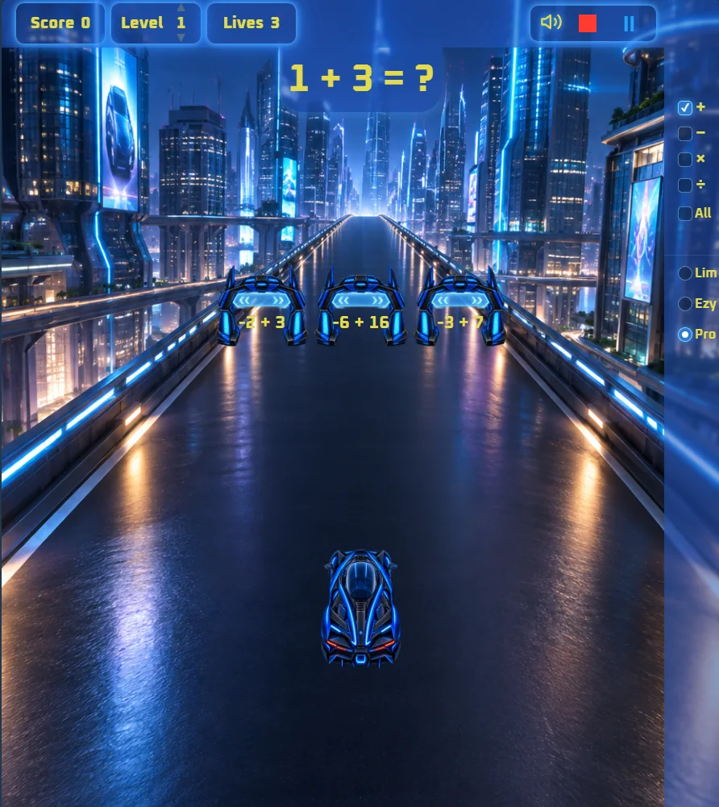
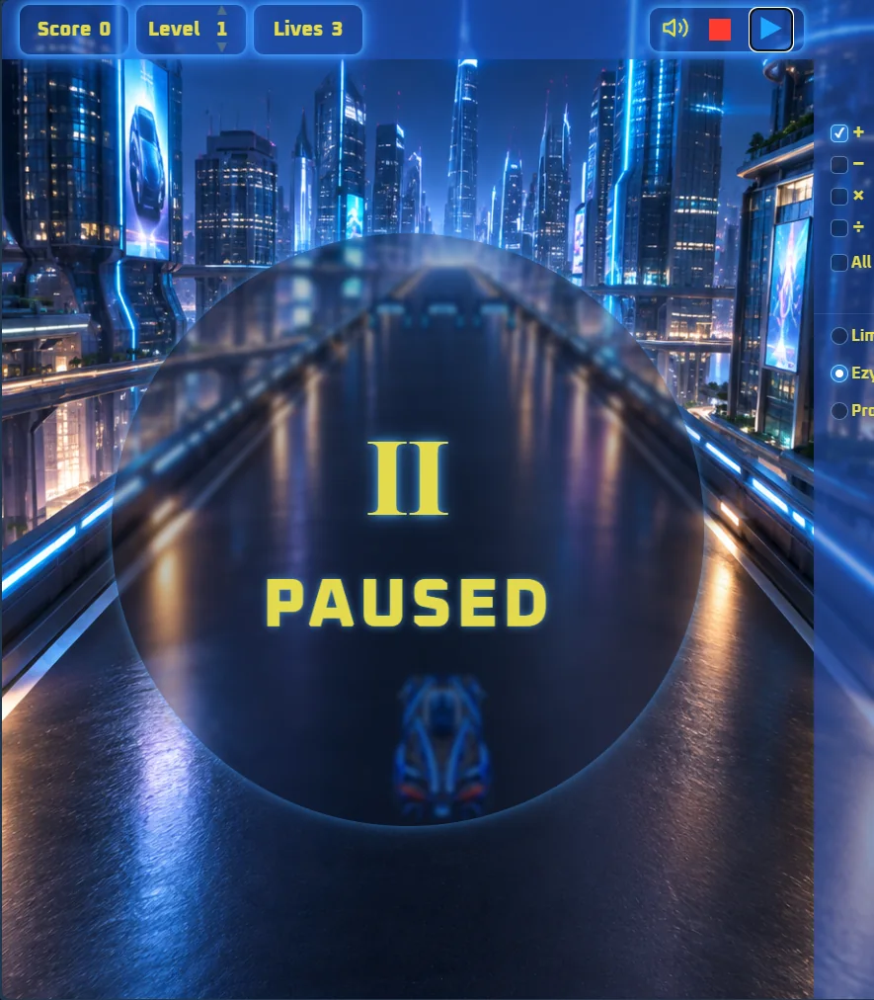

# Math Runner

**Think fast. Choose your lane. Solve the equation.**

Math Runner is an interactive, browser-based arithmetic game built entirely with **HTML, CSS and vanilla JavaScript**—no frontend framework, game engine, or backend. It combines mental arithmetic with a three-lane racing mechanic: mathematical questions appear above a futuristic road while answer gates move toward the player.

Beyond its visual presentation, the project includes procedural question generation, three distinct answer modes, keyboard and touch interaction, an animated game loop, progressive difficulty, audio feedback and locally saved level progress.

## At a glance

| | |
| --- | --- |
| **Type** | Educational arcade / arithmetic game |
| **Frontend** | HTML5, CSS3, JavaScript ES modules |
| **Dependencies** | No npm packages or build step required by the current project |
| **Game modes** | Lim, Ezy, Pro |
| **Arithmetic** | Addition, subtraction, multiplication, division |
| **Progression** | 21 levels, with unlocked progress saved in `localStorage` |
| **Controls** | Keyboard plus pointer/touch gestures |

## Screenshots

### Start screen and game settings

The start overlay includes the current score, level and lives, as well as controls for selecting arithmetic operations and an answer mode.



### Lim mode — reason about intervals

Instead of displaying three direct answers, **Lim** displays four numerical boundaries that divide the road into three possible intervals. The player must decide which interval contains the result—or select **no gate** if it falls outside all three.



### Ezy mode — select the correct result

Three moving gates display numerical answer choices. Solve the expression and steer into the appropriate lane.



### Pro mode — solve both sides

Rather than presenting simple numbers, **Pro** fills the gates with arithmetic expressions. To choose correctly, the player must solve the main question and evaluate the gate expressions.



### Pause and resume

Gameplay can be paused and resumed without leaving the current session.



## How to play

1. Choose one or several operations: **+**, **−**, **×**, **÷**, or **All**.
2. Select **Lim**, **Ezy**, or **Pro**.
3. Press **Ready!** to begin.
4. Solve the question at the top of the screen.
5. Move left or right to align with the correct gate as it approaches.
6. If none of the available gates is correct, use the dedicated **no-gate** action.
7. Build your score and progress through increasingly demanding levels.

The current implementation begins with **three lives**. Incorrect answers cost a life. Every **five correct answers** advances to the next level (up to level 21) and grants an additional life.

### Keyboard controls

| Key | Action |
| --- | --- |
| **← / →** | Change lane |
| **↓ (hold)** | Fast-forward an approaching gate |
| **Space** | Choose “no gate” |
| **Enter** | Start / pause / resume (or restart after game over) |
| **Esc** | Stop and return to the start state |
| **M** | Mute / unmute audio |
| **L + ↑ / ↓** | Switch between previously unlocked levels on the start screen |

### Pointer / touch controls

The game code also supports **left/right swipes** to change lanes, **swipe down** for fast-forward, and **double tap** to choose “no gate.” Actual usability depends on browser and device size.

## Key engineering features

### 1. Procedural mathematics

The `js/questions.js` module generates arithmetic problems based on the currently selected operations and level range. Its option generators create numerical choices, interval boundaries, or entire arithmetic expressions depending on the selected mode.

The Pro question generator takes additional care to produce integer answers for division. Option-generation logic also avoids duplicate numerical distractors and handles cases where a correct answer does not appear on any gate.

### 2. Three answer models

| Mode | How it works | Challenge |
| --- | --- | --- |
| **Lim** | Compare the result against four ordered boundaries | Interval reasoning and quick decisions |
| **Ezy** | Choose between three numerical answers | Fast mental calculation |
| **Pro** | Compare the result against three arithmetic expressions | Multi-step calculation under time pressure |

The game can also generate situations where the correct response is **none of the three gates**.

### 3. Perspective-based animation

Gate rows are created dynamically in the DOM and animated using `requestAnimationFrame`. Position, width, scale and text size change with progress to create the illusion of gates approaching the player in a three-dimensional road scene.

Collision/evaluation logic uses the rendered positions of the gate and player. The code also accounts for different viewport sizes through separate mobile-oriented perspective settings.

### 4. Explicit game state

The game uses defined states—`START`, `PLAYING`, `PAUSED`, and `GAME_OVER`—to coordinate controls, HUD updates, animations, restart behavior and overlay visibility. The `js/gameModes.js` module defines state defaults for these transitions.

### 5. Level progression and persistence

The difficulty system in `js/levels.js` uses seven number ranges—**10, 20, 50, 100, 200, 500 and 1,000**—across three speed tiers, for **21 levels** in total.

Unlocked level progress is saved in the browser's `localStorage` as `highestUnlockedLevel`, so players can return to previously unlocked stages without an account.

### 6. Interactive audiovisual feedback

The UI includes score, level and lives indicators; game-start, level-up, pause and game-over overlays; movement effects; and sound cues for correct/wrong answers, level changes and button interaction. Players can mute the audio.

## Technology stack

| Technology | Use |
| --- | --- |
| **HTML5** | Game markup, controls, HUD and overlays |
| **CSS3** | Responsive styling, futuristic visual theme and animations |
| **JavaScript (ES modules)** | Gameplay logic, arithmetic generation, state management and input |
| **DOM / browser APIs** | Dynamic gates, events, geometry, audio and `requestAnimationFrame` |
| **localStorage** | Unlocked-level persistence |

No React, canvas-based game engine or application server is used by the current implementation.

## Project structure

```text
math-runner/
├── index.html           # HUD, controls, road, overlays and game entry
├── css/
│   └── style.css        # UI, responsive layout and presentation
├── js/
│   ├── main.js          # Initializes the game
│   ├── game.js          # State, input, game loop, gates and feedback
│   ├── gameModes.js     # Game states and default values
│   ├── questions.js     # Math problems, limits and answer choices
│   ├── levels.js        # Difficulty levels and local progression
│   ├── audio.js         # Sound effects and mute management
│   └── tests/           # Browser-oriented question/test pages
├── assets/              # Game images and audio assets
└── screenshots/         # README screenshots
```

## Run locally

Because `index.html` imports JavaScript with `type="module"`, it is best to serve the project through a local HTTP server.

```bash
git clone https://github.com/housnizalam/math-runner.git
cd math-runner
python -m http.server 8000
```

Then open **http://localhost:8000/**. You can also run the folder using VS Code **Live Server**. No `npm install` or backend configuration is needed.

## Testing and project status

The repository contains browser-oriented test files under `js/tests/`, including coverage-oriented work on question generation. The full set of browser interactions and automated tests **has not been executed as part of this README review**, so the documentation describes what is present in the source code rather than making an unverified production-quality claim.

Math Runner is a personal learning and portfolio project. It demonstrates how mathematical algorithms, user interaction, game-state transitions and visual effects can be combined into a complete interactive experience using standard web technologies.

## Possible next steps

- Add a playable GitHub Pages demo.
- Run and document tests consistently across the three answer modes.
- Add keyboard/touch usage tips within the UI.
- Improve accessibility and test on a wider range of screen sizes.
- Add a short gameplay GIF to complement the static screenshots.

---

**Created by [Housni Zalam](https://github.com/housnizalam)** · HTML · CSS · JavaScript
